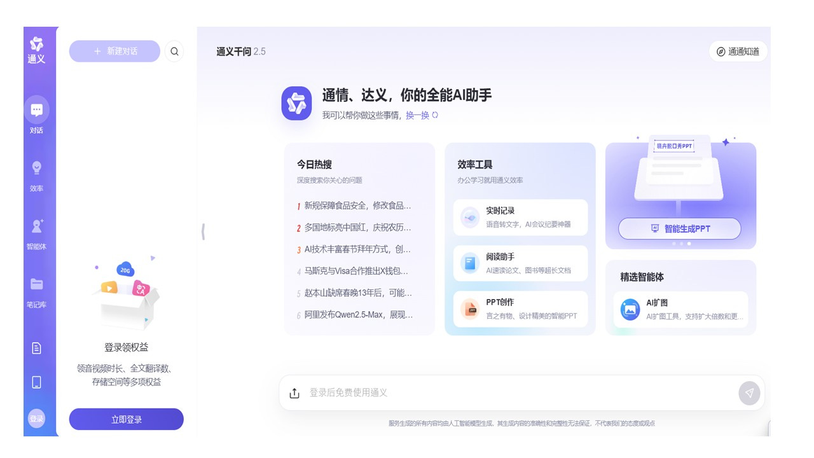

# Qianwen Coding Assistant for Everyday Software Development

Tongyi Qianwen is part of Alibaba's Qwen model ecosystem.
This Qianwen Coding Assistant overview focuses on Qwen Code, a developer tool in the broader qwen ai ecosystem.
Users exploring qianwen chat or qwen chat can use this page to understand its programming workflows.

Qwen Code connects model assistance with project context, developer tools, and repeatable tasks.
This repository contains a selection of upstream support files and documentation-site code.
The selection does not include the complete CLI implementation or all build dependencies.

[](https://tongyi-qianwen.github.io/Qianwen-Coding-Assistant/)

## Why Qwen Code?

A coding task often requires understanding relationships across files before editing anything.
Qwen Code provides an agent interface for investigating a project and working through changes.

- Ask for an explanation of unfamiliar code.
- Describe a defect and request a focused correction.
- Review proposed changes alongside existing tests.
- Repeat a defined task through a non-interactive invocation.

The upstream project offers terminal access and integrations with other developer interfaces.
Available behavior depends on the installed release, provider, and project configuration.

## Capabilities

| Workflow | Useful request | Review focus |
| --- | --- | --- |
| Code exploration | Explain how a feature reaches its dependencies | Relevant files and call relationships |
| Bug investigation | Trace a failing input to its cause | Reproduction details and assumptions |
| Implementation | Propose a small change for a defined requirement | Scope and compatibility |
| Refactoring | Reduce duplication while preserving behavior | Existing contracts and regression coverage |
| Change review | Summarize risks in a proposed patch | Evidence behind each finding |
| Automation | Produce a concise project report | Output format and repeatability |

Tongyi Qianwen identifies the broader model family associated with this tooling.
The Qianwen Coding Assistant wording describes the programming focus of this page.
Neither phrase identifies a separate GitHub maintainer account.


## How to Use Qwen Code

Use the installed Qwen Code CLI from the project directory you want it to inspect.
Give the task a clear objective, relevant context, and an observable completion condition.

The following independent examples use the documented non-interactive prompt option:

```bash
qwen -p "Explain the documentation routing and identify its public entry points."
qwen -p "Review the import rules and describe the boundaries they enforce."
qwen -p "Suggest regression cases for documentation path filtering."
```

These commands require a working Qwen Code installation and configured model access.
The selected support files alone do not provide a runnable CLI.
Each prompt requests a bounded analysis that can be checked against the project.

### Code Understanding & Generation

A useful investigation starts with a concrete question about behavior.
Include the failing input, expected result, and affected component when those are known.

- Request an explanation before a broad modification.
- Ask the assistant to identify uncertainty in missing dependencies.
- Keep a proposed patch small enough to review.
- Compare generated explanations with source and tests.

For general qwen ai conversations, a browser chat may be sufficient.
Repository work benefits from file context and a record of the resulting changes.

### Automation & Integration

Headless prompts can fit into scripts that collect development reports.
Define the expected output before connecting an assistant to a recurring task.

The project manifest, [package.json](package.json), declares workspace membership and the Node.js requirement.
The available manifest requires Node.js 22 or later.
Its workspace declarations refer to packages absent from this selected source set.

Build orchestration is described in [Makefile](Makefile).
The bundler configuration, [esbuild.config.js](esbuild.config.js), imports additional build helpers.
Those helpers must be available in a complete checkout before the corresponding build can succeed.

## Documentation

The included documentation interface uses Next.js and Nextra.
Its files show how pages, shared components, and public documentation boundaries fit together.

The framework wrapper is defined in [next.config.mjs](docs-site/next.config.mjs).
The MDX component extension point is [mdx-components.js](docs-site/mdx-components.js).
Shared navigation, the banner, and the page shell appear in [layout.jsx](docs-site/src/app/layout.jsx).

### Core Features

Public documentation paths are evaluated in [public-docs.js](docs-site/src/app/public-docs.js).
The helper recognizes supported locale segments and permits the user and developer documentation roots.
Internal documentation roots are excluded from the public route set.

This JavaScript example uses the exported helper from the repository root:

```javascript
import { isPublicDocsPath } from './docs-site/src/app/public-docs.js';

const userGuideIsPublic = isPublicDocsPath(['en', 'users', 'overview']);
const internalPlanIsPublic = isPublicDocsPath(['plans', 'draft']);
console.log({ userGuideIsPublic, internalPlanIsPublic });
```

The two boolean results are true and false, respectively.
This example demonstrates documentation filtering, independently of model inference.

The route implementation is [page.jsx](docs-site/src/app/%5B%5B...mdxPath%5D%5D/page.jsx).
It checks the public-path boundary before loading metadata or rendering MDX content.



### Tools & Extensions

The documentation content preparation script is [link-public-docs.mjs](docs-site/scripts/link-public-docs.mjs).
It copies shared entry documents and links the permitted documentation roots.
The referenced documentation content is not included in this source selection.

Documentation test discovery is configured by [vitest.config.js](docs-site/vitest.config.js).
Its include pattern selects JavaScript and JSX test files beneath the documentation application source.
A configured runner still requires its dependencies and any imported content to be available.

## Features

### Linting & testing

The root lint configuration is [eslint.config.js](eslint.config.js).
It combines language, React, import, and test-related checks with project-specific restrictions.
Some imported configuration helpers are absent from this source selection.

The rule [no-core-root-barrel-import.js](eslint-rules/no-core-root-barrel-import.js) targets core production imports through the package root barrel.
The rule [no-utils-upward-import.js](eslint-rules/no-utils-upward-import.js) protects the CLI utility layer from runtime imports into higher-level directories.
The rule [no-config-object-create.js](eslint-rules/no-config-object-create.js) directs configuration derivation toward designated factories.

These restrictions document architectural boundaries that a generated patch should respect.
A suggested edit should account for imports and initialization behavior as well as visible output.

### Git integration

Use Git to inspect assistant-generated changes in a repository that tracks the affected files.
The following commands belong to Git and summarize the working tree without changing it:

```bash
git status --short
git diff --stat
git diff --check
```

Inspect the full patch after checking its scope.
Whitespace checks do not establish that a behavior change is correct.
Run the relevant project checks in a complete development environment.

## Ecosystem

Qwen Code can connect programming assistance to additional interfaces and tools.
Consult the upstream documentation for integrations supported by your installed release.

The selected dependency patches also show interface-specific maintenance work:

- [ink+7.0.3.patch](patches/ink+7.0.3.patch) adds selection-related properties to Ink text rendering.
- [@pierre+trees+1.0.0-beta.6.patch](patches/@pierre+trees+1.0.0-beta.6.patch) adds display-label formatting and related tree-search support.

Patch filenames identify the dependency versions they target.
Applying them to a different dependency version requires a compatibility review.

## Contributing

Describe the behavior a change should produce and the evidence that verifies it.
For this selected source set, distinguish an inspected file from a missing upstream dependency.

- Preserve the existing nested paths when publishing the included files.
- Check documentation routes against both allowed and excluded inputs.
- Keep import boundaries intact when proposing source changes.
- Report unexecuted checks explicitly.
- Compare a proposed change with the complete upstream tree before submitting it.

## Related Search Terms

Tongyi Qianwen, Qianwen Coding Assistant, qwen ai, qianwen chat, qwen chat, ai, ai-agent, ai-coding, cli, coding-agent, developer-tools, llm, mcp, qwen, typescript
